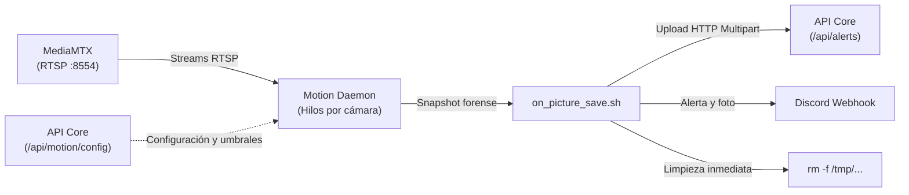

# Big Brother CCTV — Motion Detector

Microservicio centralizado y autónomo de detección de movimiento basado en **Motion Daemon** (Linux), optimizado para procesar streams RTSP de **MediaMTX**, capturar instantáneas forenses y despacharlas en tiempo real a la API Core y webhooks externos.

---

## 🌟 Características

- **Daemon Multi-Cámara Centralizado**: Un único contenedor gestiona múltiples fuentes de vídeo concurrentes mediante subprocesos aislados (`camera_id`), eliminando la necesidad de desplegar un pod por cada cámara.
- **Sincronización Dinámica con la API**: Consulta periódicamente el endpoint `/api/motion/config` de la API Core para autoconfigurar parámetros individuales por cámara (umbral de píxeles, frames mínimos de movimiento, URL RTSP).
- **Aislamiento Total de Capturas**: Cada hilo de cámara dispone de su propio directorio dedicado (`/tmp/motion_images/<camera_name>/`) y nomenclatura prefijada (`<camera_name>_%Y-%m-%d_%H-%M-%S.jpg`), evitando colisiones y condiciones de carrera.
- **Gestión Inteligente de Almacenamiento**: Limpieza inmediata (`rm -f "$FILE"`) tras el procesamiento o descarte por cooldown, con purga de seguridad cada 2 minutos para garantizar cero acumulación de residuos en disco.
- **Doble Notificación en Tiempo Real**:
  - **API Core**: Sube el snapshot forense mediante `multipart/form-data` con autenticación por token interno (`INTERNAL_TOKEN`).
  - **Discord Webhook** *(Opcional)*: Publica de inmediato una alerta enriquecida con la captura adjunta.
- **Modo Fallback Autónomo**: Si la API no está disponible en el arranque, se autoconfigura en modo local utilizando las variables de entorno predeterminadas.

---

## 📐 Arquitectura de Procesamiento



---

## ⚙️ Variables de Entorno

| Variable | Descripción | Valor por Defecto |
|---|---|---|
| `API_URL` | Endpoint de ingesta de alertas de la API Core | `http://api:8080/api/alerts` |
| `INTERNAL_TOKEN` | Token secreto compartido para autenticación interna | `internal-token-pro` |
| `COOLDOWN_SECONDS` | Intervalo mínimo (segundos) entre alertas consecutivas por cámara | `15` |
| `DISCORD_WEBHOOK` | URL de webhook de Discord para alertas externas (opcional) | `""` |
| `CAMERA_NAME` | Nombre de la cámara para el modo fallback | `camera` |
| `NETCAM_URL` | URL RTSP por defecto para el modo fallback | `rtsp://mediamtx:8554/camera` |
| `THRESHOLD` | Umbral de píxeles modificados para disparar alarma (fallback) | `350` |
| `MIN_MOTION_FRAMES` | Frames consecutivos con movimiento requeridos (fallback) | `2` |

---

## 🚀 Despliegue y Ejecución

### En Kubernetes (Helm)
El microservicio se despliega a través del chart oficial:
```bash
# Vía chart independiente
helm upgrade --install motion-detector ./helm/charts/motion-detector -n big-brother-cctv

# O dentro del umbrella chart 'big-brother'
helm upgrade --install big-brother ./helm/charts/big-brother -n big-brother-cctv
```

### En Docker / Contenedor Local
```bash
# Compilar imagen
docker build -t big-brother-cctv/motion-detector:latest .

# Ejecutar con streaming local
docker run -d --name motion-detector \
  -e API_URL="http://host.docker.internal:8080/api/alerts" \
  -e INTERNAL_TOKEN="internal-token-pro" \
  -e NETCAM_URL="rtsp://host.docker.internal:8554/camera" \
  -e COOLDOWN_SECONDS="15" \
  big-brother-cctv/motion-detector:latest
```

---

## 📁 Estructura del Proyecto

```
motion-detector/
├── Dockerfile              # Imagen basada en Alpine con motion, bash, curl y jq
├── entrypoint.sh           # Generador dinámico de configuraciones multi-hilo
├── motion.conf             # Plantilla base del daemon
├── on_picture_save.sh      # Script de despacho, cooldown y eliminación física
└── README.md               # Esta documentación
```